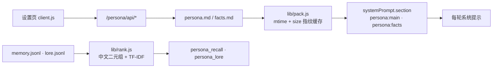

# Luminyx

给 DeepSeek Harness 的人格设定插件：把「这个会话里模型是谁」从代码搬到纯文本的人格包里，注册成系统提示的两段，再配一页能直接改这些文件的设置界面。

[](LICENSE)

一份人格包就是 `~/.dsh/persona/packs/[ID]/` 下的几个文本文件。改文件立刻生效 —— 不重启、不重装、不 patch 任何 `@deepseek-ai` 包。适合按场景换人格，或者把角色设定当代码一样 diff、备份、复制到另一台机器。

## 亮点

- **注入走官方 API，不碰宿主源码**：`ctx.systemPrompt.section()` 注册 `persona:main`（order 9100）与 `persona:facts`（9120），落在工具清单（5000）之后、结构化输出（9900）之前。段文本是函数，每轮组装重新求值，所以切包、改文件、开关注入都不需要重启或重新注册。
- **落盘是纯文本**：`persona.md` / `facts.md` 是 markdown，`lore.jsonl` / `memory.jsonl` 一行一条 JSON。手改、diff、整份复制给别的包，都不用经过本插件。
- **结构化只活在视图里**：设置页把 `## ` 切成卡片编辑，保存时序列化回同样的 markdown；手改文件回到设置页会重新解析成块。文件里没有一行 JSON 是为了插件而存在的。
- **六个工具、十四个接口，同一份数据**：模型侧 `persona_*`，界面侧 `/persona/api/*`，读写同一个 `~/.dsh/persona/`。
- **109 项自测，零依赖**：`git clone` 后直接 `npm test`，不需要先 `npm install`（`dependencies` 为空）。宿主 87 项 + 浏览器 22 项。

## 快速开始

环境：DSH `>=0.2.0-rc.1 <0.3.0-0`（`peerDependencies` 声明的范围）；Node 与 DSH 同一运行时，本仓库在 Node 24.20.0 上跑通全部测试。命令按 bash / Git Bash 写。

**没有发布到 npm**，只能从源码装。DSH 的插件挂在 profile 上，三步：

**1）放进插件目录**

```bash
git clone https://github.com/AkiraNyx/dsh-luminyx.git ~/.dsh/plugins/dsh-luminyx
```

**2）在 profile 里登记** —— 编辑 `~/.dsh/profiles/[PROFILE]/package.json`

```jsonc
{
  "dependencies": {
    "dsh-luminyx": "file:../../plugins/dsh-luminyx"
  },
  "dsh": {
    "profile": {
      "bundles": ["…原有项", "dsh-luminyx"]
    }
  }
}
```

两处都要加，缺一不生效：`dependencies` 让 Node 能解析到这个包；`bundles` 让 profile 应用它的 `cordis.patch.yml` —— 那个文件只有一条 `insert`，作用是把宿主半插进插件表。包在那儿但没进 `bundles`，就只是躺在磁盘上。

**3）装依赖并重启 DSH**

```bash
cd ~/.dsh/profiles/[PROFILE] && pnpm install   # npm / yarn 同理
```

**成功判据**：设置侧栏出现「人格设定」，并且

```bash
curl http://127.0.0.1:[PORT]/persona/api/overview
```

返回 JSON。`[PORT]` 是 DSH Web 实际监听的端口，启动日志里会打印，每次启动可能不同。宿主半的改动要重启；**改人格文件不用**。

**最小用法**

1. 设置 → 人格设定 → 「新建」，填 id（目录名，`^[a-z0-9][a-z0-9_-]{0,63}$`）、显示名、默认称呼。
2. 「人格正文」页签写这个人是谁，`Ctrl+S` / `⌘S` 保存，下一轮对话生效。
3. 「长期记忆」页签手填，或者直接对模型说「记住……」，它自己调 `persona_remember`。
4. 内置包 `example`（下拉里带 `· 内置`）是可照抄的模板；改它会先 fork 到用户目录，原文件保持干净。

**自测**

```bash
cd dsh-luminyx && npm test
# 全部通过：87 通过，0 失败
# 全部通过：22 通过，0 失败
```

测试不碰真实数据：宿主用例把 `DSH_HOME` 指向临时目录，跑完即删。

## 人格包

```text
%DSH_HOME%/persona/           默认 ~/.dsh/persona（Windows：C:\Users\[USER]\.dsh\persona）
├── active.json               { "id": "当前激活的包" }
├── settings.json             注入开关、段 order、长度上限、召回参数
├── .snapshots/[ID]/[STAMP]/  版本快照：persona.md + facts.md + pack.json + meta.json
└── packs/[ID]/
    ├── pack.json             元数据（可省略，缺省从目录名推导）
    ├── persona.md            → 段 persona:main
    ├── facts.md              → 段 persona:facts
    ├── lore.jsonl            档案，一行一条 { chapter, title, text, tags }
    ├── lore/*.md             可选，按 `##` 自动切块
    └── memory.jsonl          长期记忆，运行期写入
```

内置包在 `<插件目录>/packs/`，用户包在 `%DSH_HOME%/persona/packs/`。同名时**用户包优先**，所以可以整体接管内置包而不动安装目录。

| 文件 | 每轮注入 | 写什么 | 写法 |
| --- | --- | --- | --- |
| `persona.md` | 是，全文 | 身份、语气、工作方式、相处、边界 | `## ` 分模块 |
| `facts.md` | 是，全文 | 称呼、约定、忌讳、稳定偏好 | 一行一条 |
| `lore.jsonl` | 否，按需检索 | 世界观、往事、细节设定 | 一行一条 JSON |
| `memory.jsonl` | 否，按需检索 | 对话里沉淀的事实 | 由 `persona_remember` 写 |

分界线一句话：**每轮都要用的写进 md，可能用到的写进 jsonl。**

`pack.json` 全部字段（都可以省略）：`id`、`name`、`signature`、`aliases`、`address`、`version`、`description`、`order`、`tags`、`muted`、`createdAt`、`updatedAt`。`muted` 是停用的模块标题数组，见下文。

### 分块写法

`persona.md` 用 `## ` 分模块，第一个 `## ` 之前算文件头：

```markdown
# 示例人格｜人格设定       ← 文件头

## 身份                      ← 一个 `## ` = 一个模块
- 我是「示例人格」。         ← `- ` 列表项
跟用户长期协作的搭档。        ← 无前缀 = 普通段落行
> 「先给结论，再给依据。」    ← `> ` 引用（台词、示例）
```

编辑器里每块是一张卡：标题一个输入框、正文一个输入框、格式下拉管这一块每行的前缀 —— 「逐条要点」每行落成 `- 条目`，「成段描述」原样保留，「原样摘录」每行落成 `> 引用`。三种只是排版不同，注入的是同样这几行字。卡片可上移、下移、删除、停用；底部「添加模块」给八个预设名（身份、语气、相处方式、不做的事、连续性、工作方式、客观事实、边界），也能自己起名，重名自动加序号。

`facts.md` 只有两层：`- ` 行是条目，一条一个输入框；其余进文件头，在折叠区里只读展示 —— 要改文件头就直接改文件。

**注意**：这两个文件是**整个文件**注入的，包括文件头。头部那些「这一段会作为系统提示注入」之类的说明文字，也会一起进提示词 —— 在意这点就删掉它们。

### 停用一个模块

每张卡片有「停用」。它不删内容，只让这块不进注入：

- 开关记在 `pack.json` 的 `muted` 数组里，不另开文件，改正文不会把开关搅乱；
- 按**模块标题**匹配 —— 改标题等于换了个模块，旧开关自动失效，不会误伤同位置的新块；
- 编辑器里那块变半透明、标题划线，顶部显示「停用 N」。

### 从 Markdown 导入

「人格正文」「常驻事实」右上角都有「从 Markdown 导入」：整段粘进弹层 → 点「识别」→ 宿主回来告诉你切出几个模块、分别叫什么 → 选「替换全部」或「追加到末尾」。规则和分块写法一致。

导入只改草稿，**点保存才动文件**。

### 版本快照

「设定档案」页底部是快照区。保存 `persona.md` / `facts.md` / `pack.json` 之前自动留一份，也能点「立即备份」：

- 放在 `%DSH_HOME%/persona/.snapshots/[ID]/[STAMP]/`，每份带 `meta.json`（时间、字节数、内容指纹）；
- 内容指纹没变就不重复存，最多留 20 份，超出从最旧的删；
- 「回滚到这里」会先把当前版本备份一份，所以回滚本身也能撤回；
- 删人格包时连带清掉它的快照。

## 工作原理



三个注入细节：

- **`text` 是函数** —— 每轮组装都重新求值，这是「改文件立刻生效」的来源。读盘有缓存，缓存键是 `pack.json` / `persona.md` / `facts.md` / `lore.jsonl` 的 `mtime + size`，文件一动就失效。
- **`interpolate: false`** —— 人格文本里的 `${...}`、`{name}` 不会被当模板求值。
- **求值出错降级成空串** —— 系统提示组装抛错会让整轮请求失败，人格包里写坏一个字不该有这个后果。`strict: true` 关掉这层保护，用于调试。

长度上限（`maxChars`）不是硬切：`clampText` 尽量落在空行、句号或逗号处，并在末尾追加「（以上内容因长度上限被截断）」。

### 检索怎么算分

`persona_recall` 和 `persona_lore` 共用一个打分器（`lib/rank.js`），**不是语义检索**：

- 中文按连续汉字切二元组（「长期记忆」→ 长期/期记/记忆），拉丁字母数字按词切；
- 分数 = Σ `idf(t) × tf/(tf+1.2)` ÷ 长度归一 × 覆盖率加权，`idf` 按候选集现算；
- 记忆再乘 `0.85 + 0.06 × importance` 与新近度衰减；
- 新记忆和已有条目相似度 ≥ 0.92 视为重复，只提升重要性、不新增一条。

### 工具

| 工具 | 用途 |
| --- | --- |
| `persona_status` | 当前包、注入了哪几段、字数、档案与记忆规模 |
| `persona_packs` | `list` / `use`（切包，立即生效）/ `show` / `create` / `duplicate` / `delete` |
| `persona_recall` | 在长期记忆里检索：相关度 × 重要性 × 新近度 |
| `persona_remember` | 写一条记忆：`text` + `importance` 1–5 + 可选 `tags` |
| `persona_forget` | 按 `id` 精确删，或按 `query` 删最匹配的一条 |
| `persona_lore` | `chapters` / `read`（章节名可前缀匹配）/ `search` |

`limit` 类参数在代码里收口到 1–20：宿主只接受 JSON Schema 的一个子集，没有 `minimum` / `maximum`，所以范围写在执行逻辑里而不是 schema 里。

<details>
<summary>HTTP 接口（14 条）</summary>

设置页通过 `/persona/api/*` 读写，全部 JSON。同源使用，没有独立鉴权 —— 能访问 DSH Web 的人就能改人格。

```text
GET  /persona/api/overview        激活包、设置、全部包
GET  /persona/api/preview         当前会注入的提示词文本
GET  /persona/api/snapshots       某个包的快照列表
POST /persona/api/snapshot        { id, action: list|create|restore|remove, stamp? }
POST /persona/api/doc/parse       { kind: persona|facts, text } → 切好的结构
GET  /persona/api/pack?id=        单个包的完整内容
PUT  /persona/api/pack            { id, file, content } 存原始文件；{ id, file, doc } 存结构化文档
POST /persona/api/pack            { action: create|duplicate|delete }
PUT  /persona/api/muted           { id, titles } 停用哪些模块
PUT  /persona/api/active          { id } 切换激活包
PUT  /persona/api/settings        合并写入设置
GET  /persona/api/memory          记忆列表
POST /persona/api/memory          { action: add|forget|prune }
POST /persona/api/lore            { action: chapters|search|read }
```

包不存在返回 404，没有激活包时读写类接口返回 409。

</details>

<details>
<summary>配置</summary>

`settings.json` 里的键，界面「注入设置」页改的就是这些：

```jsonc
{
  "enabled": true,                       // 总开关
  "injectPersona": true,                 // 注入 persona:main
  "injectFacts": true,                   // 注入 persona:facts
  "exposeTools": true,                   // 暴露 persona_* 工具
  "order": { "persona": 9100, "facts": 9120 },
  "maxChars": { "persona": 24000, "facts": 6000 },
  "recall": { "limit": 5, "minScore": 0.12 }
}
```

`minScore` 有自适应下限：候选里最高分低于它时，阈值降到最高分的 0.25 倍，避免冷门话题一条都召不回来。

两个部署级键只认插件 config，界面上改不了，也不会写回 `settings.json`：

| 键 | 作用 |
| --- | --- |
| `packId` | 钉死激活包，忽略 `active.json`，界面锁住切包按钮 |
| `strict` | 注入求值出错时抛错而不是降级成空串（调试用） |

</details>

## 边界

**不适合**

- 想替换 harness 的身份段。本插件只插入自己的两段；要改 harness 身份用部署级 `personaPrefix` / `personaSuffix`。
- 把档案当向量库。`lib/rank.js` 是词频匹配，几千条以内够用；上万条建议按主题拆包。
- 多进程同时写同一个 `memory.jsonl`。写入是「读-改-原子替换」，没有文件锁。

**已知限制**

- 内置包不能直接改、不能删：写操作前自动 fork 到用户目录，删除会被拒绝（先复制成用户包再改）。
- 「停用」按模块标题匹配。同一包里两个同名标题会共用同一个开关。
- `facts.md` 整个文件注入，包括 `//` 开头的备注行 —— 备注是写给自己看的，但它仍然会进提示词。
- 客户端测试跑在自写的极简 React 垫片上（`test/client-load.mjs`），不是真实浏览器：能证明组件注册、数据流和首屏渲染，证明不了像素级布局。

**未验证**

- 只在 Windows + Node 24.20.0 上跑过完整测试。macOS / Linux 没测。
- `peerDependencies` 写的是 `>=0.2.0-rc.1 <0.3.0-0`，但只在本机那一版 DSH 上验证过。更高版本是否仍兼容，没测。

---

许可证：[MIT](LICENSE)。
