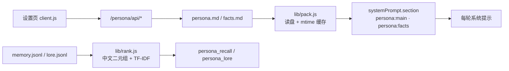

# Luminyx

**给 DeepSeek Harness 的人格设定插件** —— 把「这个会话里模型是谁」从代码里搬到纯文本的人格包，注册成系统提示的两段，再配一页能直接改这些文件的设置界面。

[](LICENSE)

一份人格包就是 `~/.dsh/persona/packs/[ID]/` 下的几个文本文件。改文件立刻生效，不用重启、不用重装、不 patch 任何 `@deepseek-ai` 包。适合需要按场景换人格、或想把角色设定当代码一样 diff 和备份的用法。

## 亮点

- **注入走官方 API**：`ctx.systemPrompt.section()` 注册 `persona:main`（order 9100）与 `persona:facts`（9120），落在工具清单（5000）之后、结构化输出（9900）之前。`text` 是函数，每次组装提示词重新求值，所以切包、改内容、开关注入都不需要 dispose/register。
- **落盘只有纯文本**：`persona.md` / `facts.md` 是 markdown，`lore.jsonl` / `memory.jsonl` 一行一条 JSON。手改、diff、整份复制给别的包都不用经过本插件。
- **编辑器和文件双向同步**：设置页把 `## ` 切成卡片编辑，保存时序列化回同样的 markdown；手改文件回到设置页会重新解析成块 —— 结构化只活在视图里。
- **六个工具，十四个接口**：模型侧 `persona_*`，界面侧 `/persona/api/*`，读写同一批文件。
- **自测零依赖**：`git clone` 后直接 `npm test`，不需要先 `npm install`（`dependencies` 为空）。共 109 项：宿主 87 + 浏览器 22。

## 快速开始

环境：DSH `>=0.2.0-rc.1 <0.3.0-0`（`peerDependencies` 声明的范围）；Node 与 DSH 同一运行时，本仓库在 Node 24.20.0 上跑通全部测试。下面命令按 bash / Git Bash 写。

**本包没有发布到 npm**，只能从源码装。DSH 的插件挂在 profile 上，三步：

1）放到插件目录

```bash
git clone https://github.com/AkiraNyx/dsh-luminyx.git ~/.dsh/plugins/dsh-luminyx
```

2）让 profile 认识它 —— 编辑 `~/.dsh/profiles/[PROFILE]/package.json`

```jsonc
{
  "dependencies": {
    "dsh-luminyx": "file:../../plugins/dsh-luminyx"
  },
  "dsh": {
    "profile": {
      "bundles": ["…原有项", "dsh-luminyx"]
    }
  }
}
```

3）装依赖，然后重启 DSH

```bash
cd ~/.dsh/profiles/[PROFILE] && pnpm install   # npm / yarn 同理
```

**成功判据**：设置侧栏出现「人格设定」，并且

```bash
curl http://127.0.0.1:[PORT]/persona/api/overview
```

返回 JSON（`[PORT]` 是 DSH Web 实际监听的端口，启动日志里会打印）。宿主半的改动需要重启；**改人格文件不需要**。

**最小用法**

1. 设置 → 人格设定 → 「新建」，填 id（目录名，小写字母 / 数字 / `-` / `_`）、显示名、默认称呼。
2. 「人格正文」页签写这个人是谁，`Ctrl+S` / `⌘S` 保存，下一轮对话生效。
3. 「长期记忆」页签手填几条，或者直接对模型说「记住……」，它会自己调 `persona_remember`。
4. 内置包 `example`（下拉里带 `· 内置`）是一份可照抄的模板；改它会自动 fork 到用户目录，原文件保持干净。

**自测**

```bash
cd dsh-luminyx && npm test
# 全部通过：87 通过，0 失败
# 全部通过：22 通过，0 失败
```

测试不碰真实数据：宿主用例把 `DSH_HOME` 指向临时目录，跑完即删。

## 人格包

```text
~/.dsh/persona/
├── active.json         { "id": "当前激活的包" }
├── settings.json       注入开关、段 order、长度上限、召回参数
└── packs/
    └── [ID]/
        ├── pack.json   id / name / address / description / version / tags
        ├── persona.md  → 系统提示段 persona:main
        ├── facts.md    → 系统提示段 persona:facts
        ├── lore.jsonl  设定档案，一行一条 {id, chapter, title, text, tags}
        ├── memory.jsonl 长期记忆，运行期写入
        └── muted.json  停用的模块标题
```

| 文件 | 每轮注入 | 写什么 |
|---|---|---|
| `persona.md` | 是，全文 | 身份、语气、工作方式、相处、边界 |
| `facts.md` | 是，全文 | 称呼、约定、忌讳、稳定偏好，一条一行 |
| `lore.jsonl` | 否，按需检索 | 章节化长文：世界观、往事、细节设定 |
| `memory.jsonl` | 否，按需检索 | 对话里沉淀下来的事实 |

分界线一句话：**每轮都要用的写进 md，可能用到的写进 jsonl。**

### 分块写法

`persona.md` 用 `## ` 分模块。第一个 `## ` 之前的内容算文件头（说明文字，一起注入），之后每个 `## 标题` 是一个模块，模块里的行按前缀决定写法：

```markdown
# 示例人格｜人格设定      ← 文件头：说明文字

> 这一段作为系统提示注入。

## 身份                     ← 一个模块 = 一个 `## `
- 我是「示例人格」。        ← `- ` 列表项
跟用户长期协作的搭档。       ← 无前缀 = 普通段落行
> 「先给结论，再给依据。」    ← `> ` 引用（台词、示例）
```

设置页把每个 `## ` 渲染成一张卡片：标题一个输入框、正文一个输入框，外加「列表 / 段落 / 引用」下拉决定这行落盘时加不加 `- ` 或 `>`。卡片可上下移动、删除，底部「添加模块」按预设名一键新建，也能自定义命名。

`facts.md` 只有两层：非列表行进文件头，`- ` 行进条目列表，每条一个输入框。

**结构化只存在于编辑器里**，所以：手改 `persona.md` 完全没问题；整个文件可以复制给别的包；块顺序就是注入顺序，删一块只删那个模块。

### 停用一块

每个模块卡片上有「停用」。它不改文件内容，只让这一块不进注入文本：

- 开关落在独立的 `muted.json`（`["语气","背景"]`），改正文不会把开关搞乱；
- 按**模块标题**匹配 —— 改了标题，旧开关自动失效，不会误伤同位置的新模块；
- 编辑器里半透明 + 标题划线，顶部显示「停用 N」。

### 从 Markdown 导入

「人格正文」「常驻事实」右上角都有「从 Markdown 导入」：整段粘进弹层 → 点「识别」→ 宿主回来告诉你切出几个模块、分别叫什么 → 选「替换全部」或「追加到末尾」。

规则和分块写法一致（`## ` 切块，`// ` 开头是注释）。导入只落草稿，**点保存才动文件**。

### 版本快照

「设定档案」页底部是快照区。**每次保存前自动留一份**（`persona.md` + `facts.md` + `pack.json`），也能手动「立即备份」：

- 位置 `~/.dsh/persona/.snapshots/[ID]/[STAMP]/`；
- 内容没变不重复堆，默认留 20 份，超出从最旧的删；
- 「回滚到这里」会先把当前版本备份一份，所以回滚本身也能撤回；
- 删人格包时连带清掉它的快照。

## 工作原理



三个设计决定：

- **`text` 用函数而不是字符串** —— 每次组装提示词都重新读盘（带 mtime 缓存，不是每轮真读 IO）。这是「改文件立刻生效」的来源。
- **`interpolate: false`** —— 人格文本里出现 `${...}`、`{name}` 是常事，不能被当模板求值。
- **求值失败降级成空串** —— 系统提示组装抛错会让整轮请求失败，人格包写坏一个字不该有这个后果。`config.strict = true` 关掉这层保护，用于调试。

### 工具

| 工具 | 作用 |
|---|---|
| `persona_status` | 现在是谁、注入了什么、档案与记忆规模 |
| `persona_packs` | 列 / 建 / 复制 / 切换 / 删除人格包 |
| `persona_recall` | 在长期记忆里按相关度检索 |
| `persona_remember` | 写一条记忆（重要性 1–5） |
| `persona_forget` | 按 id 或内容删一条 |
| `persona_lore` | 列章节 / 检索 / 读档案条目 |

<details>
<summary>HTTP 接口（14 条）</summary>

设置页通过 `/persona/api/*` 读写，全部 JSON，同源使用、无独立鉴权。

```text
GET  /persona/api/overview          激活包、设置、全部包
GET  /persona/api/preview           当前会注入的提示词文本
GET  /persona/api/snapshots         某个包的快照列表
POST /persona/api/snapshot          { id, action: list|create|restore|remove, stamp? }
POST /persona/api/doc/parse         { kind: persona|facts, text } → 切好的结构
GET  /persona/api/pack?id=         单个包的完整内容
PUT  /persona/api/pack             { id, file, content } 存原始文件；{ id, file, doc } 存结构化文档
POST /persona/api/pack             { action: create|duplicate|delete }
PUT  /persona/api/muted            { id, titles } 停用哪些模块
PUT  /persona/api/active           { id } 切换激活包
PUT  /persona/api/settings         合并写入设置
GET  /persona/api/memory           记忆列表
POST /persona/api/memory           { action: add|forget|prune }
POST /persona/api/lore             { action: chapters|search|read }
```

没有激活包时读写类接口返回 409。

</details>

<details>
<summary>配置</summary>

写进 `settings.json`，或用插件 config 覆盖（config 优先，且不写回文件）：

```jsonc
{
  "enabled": true,
  "injectPersona": true,
  "injectFacts": true,
  "exposeTools": true,
  "order": { "persona": 9100, "facts": 9120 },
  "maxChars": { "persona": 24000, "facts": 6000 },
  "recall": { "limit": 5, "minScore": 0.12 }
}
```

部署级固定（只认 config，界面上不可改）：

| 键 | 作用 |
|---|---|
| `packId` | 钉死激活包，忽略 `active.json`，界面锁住切换 |
| `strict` | 注入求值出错时抛错而不是降级（调试用） |

</details>

## 边界

**不适合**

- 想替换 harness 身份段本身 —— 本插件只插入自己的两段。要改 harness 身份用部署级 `personaPrefix` / `personaSuffix`。
- 把档案当向量库用。`lib/rank.js` 是中文二元组 + TF-IDF + 长度归一，几百到几千条够用，上万条建议自己拆包。
- 多进程高频写同一个 `memory.jsonl`。写入是追加 + 原子替换，没有文件锁。

**已知限制**

- 内置包不可编辑、不可删：写操作前自动 fork 到用户目录。
- 「停用」按模块标题匹配。同一包里两个同名标题会共用同一个开关。
- 客户端测试跑在自写的极简 React 垫片上（`test/client-load.mjs`），不是真实浏览器 —— 它能证明组件注册、数据流转和首屏渲染，证明不了像素级布局。

**未验证**

- 只在 Windows + Node 24.20.0 上跑过完整测试。macOS / Linux 没测。
- `peerDependencies` 声明的是 `@deepseek-ai/dsh >=0.2.0-rc.1 <0.3.0-0`，但只在本机那个版本的 DSH 上验证过。更高版本是否仍兼容，没测。

---

许可证：[MIT](LICENSE)。
